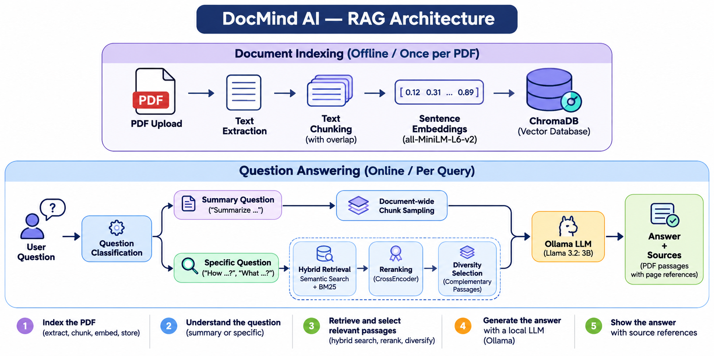
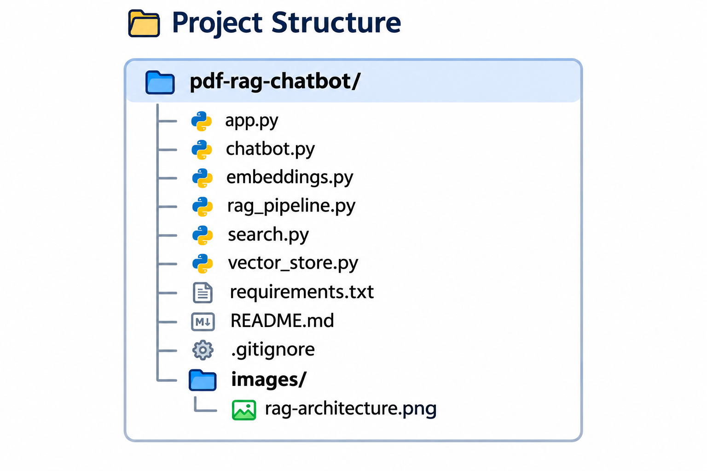


# DocMind AI-Local PDF RAG Chatbot

DocMind AI is a local AI-powered document assistant that allows users to upload PDF files and ask questions about their content.

The application uses Retrieval-Augmented Generation (RAG) to combine document retrieval with a local Large Language Model (LLM), generating context-aware answers supported by references to the original PDF.

Unlike cloud-based AI applications, DocMind AI runs locally using Ollama.

## RAG Architecture



The architecture consists of two main stages:

1. Document indexing: extracting PDF text, splitting it into chunks, generating embeddings, and storing them in ChromaDB.
2. Question answering: identifying the question type, retrieving relevant passages, reranking them, and generating an answer using a local LLM.

## Features

- PDF upload and text extraction
- Automatic text chunking with overlap
- Semantic embeddings using SentenceTransformers
- Persistent vector storage with ChromaDB
- Hybrid retrieval combining semantic similarity and BM25
- CrossEncoder reranking for improved relevance
- Diversity-aware passage selection
- Document summarization
- Question answering based on PDF content
- Source references with PDF page numbers
- Interactive chat interface using Streamlit
- Local LLM inference through Ollama
- Persistent document indexing to avoid unnecessary reprocessing

## Technologies Used

| Component | Technology |
|-----------|------------|
| Programming language | Python 3.10 |
| User interface | Streamlit |
| PDF extraction | PyPDF |
| Text splitting | LangChain |
| Embedding model | all-MiniLM-L6-v2 |
| Vector database | ChromaDB |
| Keyword retrieval | BM25 |
| Reranking model | ms-marco-MiniLM-L-6-v2 |
| Language model | Llama 3.2 (3B) |
| Local model runtime | Ollama |

## How It Works

### 1. PDF Processing

When a user uploads a PDF, the application extracts its text using PyPDF.

The extracted text is divided into smaller overlapping chunks using LangChain's RecursiveCharacterTextSplitter.

Chunk configuration:

- Chunk size: 1000 characters
- Chunk overlap: 200 characters

Each chunk retains its source page information.

### 2. Embedding Generation

The application uses the `all-MiniLM-L6-v2` SentenceTransformer model to transform text chunks into 384-dimensional vector embeddings.

These embeddings represent the semantic meaning of the document passages.

### 3. Vector Storage

The generated embeddings are stored in ChromaDB, a local vector database.

Document indexing is persistent, allowing previously processed documents to be reused without generating embeddings again.

### 4. Question Analysis

When a user asks a question, the application identifies whether the request is a general document summary or a specific question.

Summary questions use document-wide passage sampling.

Specific questions use the hybrid retrieval pipeline.

### 5. Hybrid Retrieval

For specific questions, the application combines two retrieval methods:

- Semantic search: identifies passages that are conceptually related to the question.
- BM25: identifies passages containing relevant keywords.

Combining both approaches helps retrieve passages based on meaning and terminology.

### 6. CrossEncoder Reranking

The retrieved candidates are reranked using the `cross-encoder/ms-marco-MiniLM-L-6-v2` model.

The CrossEncoder evaluates each question-passage pair and assigns a relevance score.

This improves the ordering of candidate passages before answer generation.

### 7. Diversity-Aware Passage Selection

The application selects a small set of complementary passages to reduce redundant context.

This helps the language model receive information from different relevant parts of the document.

### 8. Answer Generation

The selected passages and the user's question are sent to the local Llama 3.2 (3B) model through Ollama.

The prompt instructs the model to:

- Answer using the retrieved PDF passages.
- Avoid inventing information.
- Explain important mechanisms when relevant.
- Distinguish the proposed method from methods mentioned for comparison.
- Acknowledge insufficient context.
- Use simple, understandable language.

The generated response is displayed in the Streamlit interface alongside source references.

## Installation

### Prerequisites

Before running the project, install:

- Python 3.10
- Git
- Ollama

Ollama can be downloaded from:

https://ollama.com

### 1. Clone the Repository

```bash
git clone https://github.com/HAJAREUNOIA/pdf-rag-chatbot.git
cd pdf-rag-chatbot
```

Replace `HAJAREUNOIA` with your GitHub username.

### 2. Create a Virtual Environment

```bash
python -m venv .venv
```

### 3. Activate the Environment

On Windows PowerShell:

```powershell
.\.venv\Scripts\Activate.ps1
```

### 4. Install Dependencies

```bash
pip install -r requirements.txt
```

### 5. Download the Language Model

```bash
ollama pull llama3.2:3b
```

Make sure Ollama is running before launching the application.

The embedding and reranking models are downloaded automatically when first used, so an internet connection may be required for the initial setup.

### 6. Launch DocMind AI

```bash
streamlit run app.py
```

Streamlit will display a local URL, typically:

http://localhost:8501

Open the URL in your browser to use the application.

## Usage

1. Launch the Streamlit application.
2. Upload a PDF document.
3. Wait for the document to be processed and indexed.
4. Enter a question about the uploaded document.
5. Read the generated answer and inspect the supporting source passages.
6. Ask follow-up questions or request a document summary.

Example questions:

- What is the main objective of this paper?
- Explain the proposed methodology.
- How does the proposed algorithm work?
- What are the limitations discussed by the authors?
- Summarize the document.

## Project Structure



The exact source file layout may vary. Local data, generated indexes, and virtual environment files are excluded from Git.

## Privacy and Local Execution

DocMind AI uses a locally running language model through Ollama.

Document processing, vector storage, and answer generation are designed to run locally. The application does not require a hosted LLM API for normal use.

Models may need to be downloaded during initial setup.

## Limitations

- The quality of generated answers depends on the retrieved passages and the local language model.
- The language model may occasionally generate inaccurate or incomplete answers.
- Scanned or image-only PDFs are not supported without OCR.
- Processing large documents can require additional time and memory.
- Performance depends on the available hardware.
- The application currently works with one active PDF at a time.

## Future Improvements

- Support question answering across multiple PDFs
- Integrate OCR for scanned documents
- Introduce automated RAG evaluation metrics
- Improve retrieval efficiency
- Experiment with alternative embedding and reranking models
- Support additional local LLMs
- Improve document comparison capabilities

## Project Motivation

DocMind AI was developed as a practical project to explore modern Retrieval-Augmented Generation techniques.

The goal was to understand and implement a complete RAG pipeline, including document preprocessing, semantic embeddings, hybrid information retrieval, neural reranking, context selection, and local language model inference.


